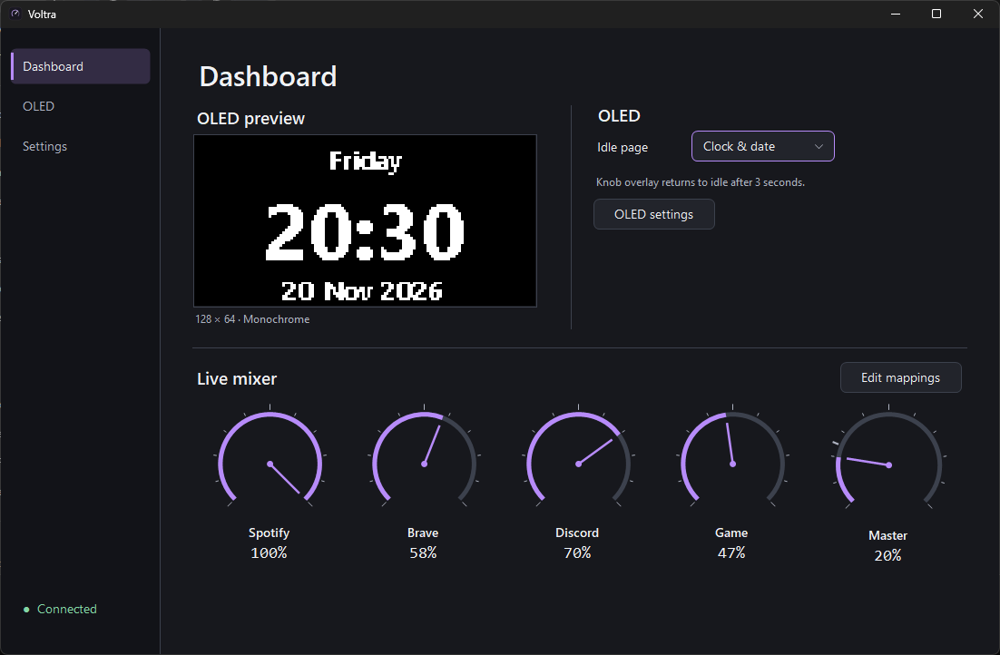
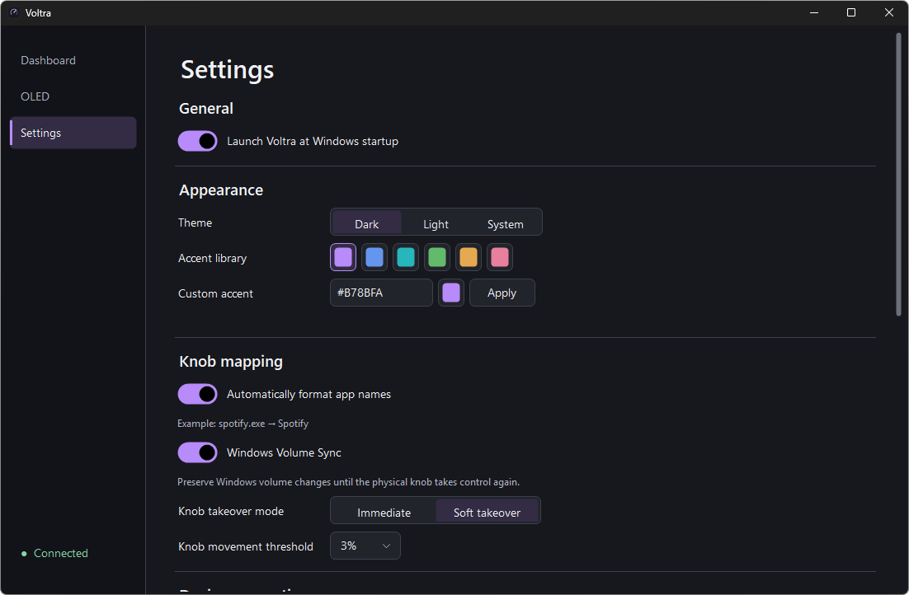
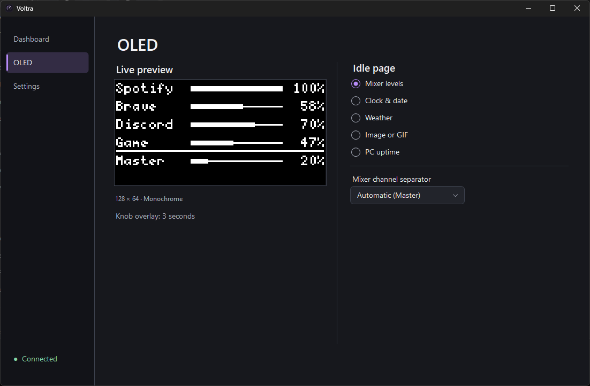

# Voltra

**Voltra is a customizable, cross-platform desktop audio mixer powered by an ESP32-S3 controller.**

Control the volume of individual applications and your system audio using five physical knobs, with real-time feedback on a 128×64 OLED display.

Built with C# and .NET 10, Voltra supports Windows and Linux with platform-specific audio backends and a shared hardware protocol.



## Features

### Audio Control

- Five independently configurable physical volume knobs.
- Per-application volume control.
- Master system volume control.
- Assign multiple applications to a single knob.
- Real-time audio level synchronization.
- Soft Takeover to prevent sudden volume jumps.
- Immediate Takeover for direct hardware control.
- Configurable movement and noise thresholds.
- Automatic detection of active audio applications.
- Automatic reconnection to the ESP32 controller.
- Persistent channel mappings and preferences.

### Desktop Application

- Dark, Light, and System themes.
- Customizable accent colors.
- HEX color selection.
- Dashboard with live volume indicators.
- Configurable application mappings.
- OLED configuration and preview.
- Device connection settings.
- System tray integration.
- Optional launch at system startup.
- Application update checking.
- Firmware version detection.



### OLED Display

Voltra includes configurable display pages for a 128×64 monochrome OLED.

Available pages:

- **Mixer Levels** — displays application labels and their current volume levels.
- **Clock & Date** — shows the current time and date.
- **Weather** — displays current weather information for a configured city.
- **Image & GIF** — displays custom images and animated GIFs.
- **PC Uptime** — displays system uptime.

Additional functionality:

- Automatic return to the selected idle page after adjusting a knob.
- Configurable Master channel separators.
- OLED framebuffer preview inside the desktop application.
- Automatic synchronization between desktop software and the controller.
- Standalone display behavior supported by compatible firmware.



## Supported Platforms

| Platform | Status | Audio Backend | Interface |
|---|---|---|---|
| Windows 10/11 | Supported | WASAPI | Windows Forms |
| Linux x64 | Experimental | PipeWire / pipewire-pulse | Avalonia UI |
| macOS | Not yet supported | — | — |

Both desktop applications communicate with the same ESP32-S3 firmware over USB Serial.

The Linux version is currently under active development. Its interface and platform integration may differ from the Windows version.

## Hardware Requirements

Voltra is designed for the **Waveshare ESP32-S3-Zero**, using:

- ESP32-S3 microcontroller.
- Five B10K potentiometers.
- 128×64 I²C OLED display.
- USB data connection.

### GPIO Configuration

| Component | GPIO |
|---|---|
| Potentiometer 1 | GPIO11 |
| Potentiometer 2 | GPIO7 |
| Potentiometer 3 | GPIO8 |
| Potentiometer 4 | GPIO9 |
| Potentiometer 5 | GPIO10 |
| OLED SCL | GPIO12 |
| OLED SDA | GPIO13 |

Each potentiometer's center pin connects to its assigned GPIO. The outer pins connect to 3.3V and GND.

The OLED uses I²C and shares the controller's 3.3V power and ground connections.

Check that your OLED module supports 3.3V operation before connecting it.

## Installation

### Windows

1. Open the [GitHub Releases](https://github.com/zixxi/release-voltra/releases) page.
2. Download the latest Windows installer, named similar to `Voltra-VERSION-win-x64.exe`.
3. Run the installer.
4. Launch Voltra.
5. Connect the ESP32-S3-Zero using a USB data cable.
6. Wait for automatic device detection.
7. Configure your five channel mappings.

Voltra is installed for the current Windows user without requiring administrator privileges.

Application settings are stored in:

```text
%LOCALAPPDATA%\Voltra\
```

### Linux

The Linux version requires a desktop environment with PipeWire, WirePlumber, and the PulseAudio compatibility service (`pipewire-pulse`).

Ubuntu and Fedora are the initial target distributions.

#### Install dependencies

On Ubuntu:

```bash
sudo apt update
sudo apt install pulseaudio-utils
```

On Fedora:

```bash
sudo dnf install pulseaudio-utils
```

Verify that PipeWire's PulseAudio compatibility service is available:

```bash
pactl info
```

The server should identify itself as PulseAudio running on PipeWire.

#### Download and run

Download the Linux x64 archive from [GitHub Releases](https://github.com/zixxi/release-voltra/releases) when a Linux package is available.

Extract the archive:

```bash
mkdir -p ~/Applications/Voltra
tar -xzf Voltra-VERSION-linux-x64.tar.gz -C ~/Applications/Voltra
```

Then run:

```bash
cd ~/Applications/Voltra
chmod +x ./LinuxApp
./LinuxApp
```

The commands assume the executable is directly inside the extracted directory.

The self-contained Linux distribution includes the required .NET runtime.

#### USB Serial Permissions

On Linux, the ESP32 may appear as:

```text
/dev/ttyACM0
```

Or through a persistent device path:

```text
/dev/serial/by-id/
```

If Voltra cannot access the serial device, check its permissions:

```bash
ls -l /dev/ttyACM0
```

On systems where the device belongs to the `dialout` group, add your user:

```bash
sudo usermod -aG dialout "$USER"
```

Log out completely and log back in.

Verify your membership:

```bash
id -nG
```

The output should include `dialout`.

Run Voltra as your normal user. Administrator privileges should not be required.

#### Linux Settings

Configuration files are stored in:

```text
~/.config/Voltra/
```

When `XDG_CONFIG_HOME` is set, Voltra uses that location instead.

Linux startup integration uses an XDG Autostart entry.

System tray functionality depends on the desktop environment and available StatusNotifier/AppIndicator support.

## Device Firmware

Voltra uses firmware designed for the ESP32-S3-Zero.

The firmware handles:

- Analog potentiometer readings.
- USB Serial communication.
- Device identification.
- OLED rendering and synchronization.
- Display page persistence.
- Connection timeout behavior.
- Firmware version reporting.

### Initial Firmware Installation

A new controller requires an initial firmware upload.

1. Install [Arduino IDE](https://www.arduino.cc/en/software).
2. Install **esp32 by Espressif Systems** through Boards Manager.
3. Install the **U8g2** library.
4. Open:

```text
VoltraFirmware/VoltraFirmware.ino
```

5. Select the appropriate ESP32-S3 board configuration.
6. Enable **USB CDC On Boot** when using the native USB interface.
7. Select the correct USB port.
8. Compile and upload the firmware.

Once uploaded, the controller should communicate with the desktop application over USB Serial.

The default communication speed is 115200 baud.

### Firmware Updates

The Windows application includes a firmware update system for supported controllers.

Its update process includes:

- Firmware version detection.
- Hardware compatibility verification.
- Signed update manifest verification.
- SHA-256 integrity verification.
- Guided bootloader entry.
- Firmware flashing and verification.
- Automatic reconnection after updating.

Firmware releases use the dedicated GitHub release tag:

`firmware-s3-zero`

Firmware updates are separate from desktop application updates.

**Linux firmware flashing is not currently supported through the desktop application.** Use the existing manual firmware workflow when necessary.

## Application Updates

### Windows

Voltra can check GitHub for new stable releases.

The Windows update mechanism verifies signed release metadata and installer integrity before proceeding.

A typical Windows release contains:

```text
Voltra-VERSION-win-x64.exe
Voltra-VERSION-win-x64.exe.json
Voltra-VERSION-win-x64.exe.json.sig
```

The manifest uses SHA-256 checksums and an RSA-PSS signature.

The private signing key is not included in the application or repository.

### Linux

The Linux version supports checking for compatible application releases.

Available updates can be downloaded and installed manually.

Automatic Linux package installation is not currently implemented.

## Building from Source

Voltra uses **.NET 10**.

Repository structure:

```text
release-voltra/
├── WindowsApp/
├── LinuxApp/
├── Voltra.Core/
├── VoltraFirmware/
├── Installer/
├── assets/
├── Directory.Build.props
├── Voltra.slnx
├── README.md
├── RELEASING.md
└── LICENSE
```

### Windows Build

Requirements:

- Windows 10/11.
- .NET 10 SDK.
- Visual Studio with .NET desktop development support, or another compatible .NET development environment.

Build:

```powershell
dotnet build .\WindowsApp\Voltra.csproj -c Release
```

Publish:

```powershell
dotnet publish .\WindowsApp\Voltra.csproj -c Release -r win-x64 --self-contained true -o .\publish\win-x64
```

The repository also includes a Windows installer build script:

```powershell
powershell.exe -NoProfile -ExecutionPolicy Bypass -File .\Build-Installer.ps1
```

Installer packaging uses Inno Setup.

### Linux Build

Requirements:

- .NET 10 SDK.
- Linux desktop environment with the required graphics libraries.
- PipeWire-compatible audio services.

Run from source:

```bash
dotnet run --project LinuxApp/LinuxApp.csproj
```

Build:

```bash
dotnet build LinuxApp/LinuxApp.csproj -c Release
```

Publish a self-contained Linux x64 application:

```bash
dotnet publish LinuxApp/LinuxApp.csproj -c Release -r linux-x64 --self-contained true -o publish/linux-x64
```

Run the published application:

```bash
cd publish/linux-x64
chmod +x ./LinuxApp
./LinuxApp
```

A Linux publish operation may also be performed from Windows using the .NET SDK, but the resulting application must be tested on Linux.

### Shared Components

`Voltra.Core` contains reusable platform-independent components shared between desktop implementations.

Platform-specific responsibilities remain separated:

- **WindowsApp** — Windows Forms, WASAPI, Windows integration.
- **LinuxApp** — Avalonia, PipeWire integration, XDG desktop integration.
- **Voltra.Core** — shared application logic and models.
- **VoltraFirmware** — ESP32 device firmware.

## Troubleshooting

### Controller Not Detected

- Use a USB cable that supports data transfer.
- Close Arduino Serial Monitor and other programs using the serial port.
- Confirm that the ESP32 firmware is running.
- Check the selected device in Voltra's Settings.
- On Linux, verify access to `/dev/ttyACM0` and membership in the required serial device group.
- Reconnect the controller and restart Voltra if necessary.

### Applications Not Appearing

Audio applications generally need to have an active playback stream before the operating system exposes them for individual volume control.

Start audio playback in the target application and refresh or reapply its mapping.

### Linux Audio Not Working

Verify the PipeWire compatibility service:

```bash
pactl info
```

List available playback streams:

```bash
pactl list sink-inputs short
```

Confirm that `pipewire-pulse` and the audio session manager are running.

### OLED Not Updating

- Confirm that the controller is connected.
- Check the selected OLED page.
- Verify the I²C connections.
- Confirm that the firmware supports the selected display.
- Make sure another application is not using the serial port.

## Project Status

Voltra is under active development.

The Windows version is the primary implementation.

The Linux version is available as an experimental port, with continuing work focused on interface consistency, OLED rendering parity, desktop integration, and hardware testing.

macOS support may be considered in the future but is not currently available.

## License

Voltra is licensed under the **PolyForm Noncommercial License 1.0.0**.

You may use, study, modify, and redistribute the project subject to the license terms.

Commercial use is not permitted without separate authorization.

See the [LICENSE](LICENSE) file for the complete terms.

This project is source-available and is not licensed under an OSI-approved open-source license.

## Repository

**GitHub:** [zixxi/release-voltra](https://github.com/zixxi/release-voltra)

**Releases:** [Download Voltra](https://github.com/zixxi/release-voltra/releases)

**Issues:** [Report a bug or suggest a feature](https://github.com/zixxi/release-voltra/issues)

---

Copyright © 2026 importsys.

Voltra is an independent project.
